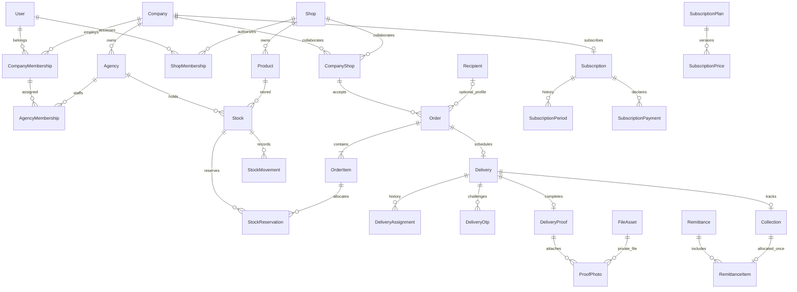

# Relations principales

Le diagramme décrit les cardinalités métier visées. Il ne force pas une commande à avoir une ligne dès son insertion : le service de confirmation devra vérifier qu’elle n’est pas vide. De même, une livraison reste sans preuve tant qu’elle n’est pas terminée.

## Contraintes composées importantes

- Agency : référence unique par companyId, jamais globale.
- AgencyMembership : entreprise/agence/utilisateur unique, avec une affiliation CompanyMembership existante dans la même entreprise.
- CompanyShop : entreprise/boutique unique ; aucune duplication du catalogue d’une boutique multi-entreprises.
- Stock : entreprise/agence/boutique/produit unique. FK vers partenariat, agence et produit de la boutique.
- OrderItem : FK (companyId, orderId, shopId), pour empêcher le mélange de boutiques dans une commande.
- StockReservation : même entreprise/boutique/produit pour le stock et la ligne de commande. Les mouvements liés à une réservation référencent aussi son stock.
- Delivery : une livraison principale par commande. Les tentatives/réaffectations sont des événements et affectations historiques.
- DeliveryProof : une seule preuve de validation par livraison et un OTP ne peut être utilisé que dans une preuve. Les FK incluent entreprise, livraison et livreur pour la preuve.
- Collection : une déclaration financière principale par livraison, indépendante de son statut logistique.
- RemittanceItem : un encaissement ne peut appartenir qu’à une allocation. Les clés incluent entreprise, livreur, agence et devise sur les deux parents.
- Subscription : une par entreprise, indépendamment du nombre d’agences. Les périodes référencent un tarif du même plan et de la même devise ; le paiement lié appartient au même abonnement et à la même devise.

Les relations complètes, champs et index sont la source de vérité dans api/prisma/schema.prisma. Les CHECK et triggers complémentaires sont dans la deuxième migration ; ils ne sont pas représentables intégralement dans le schéma Prisma.
